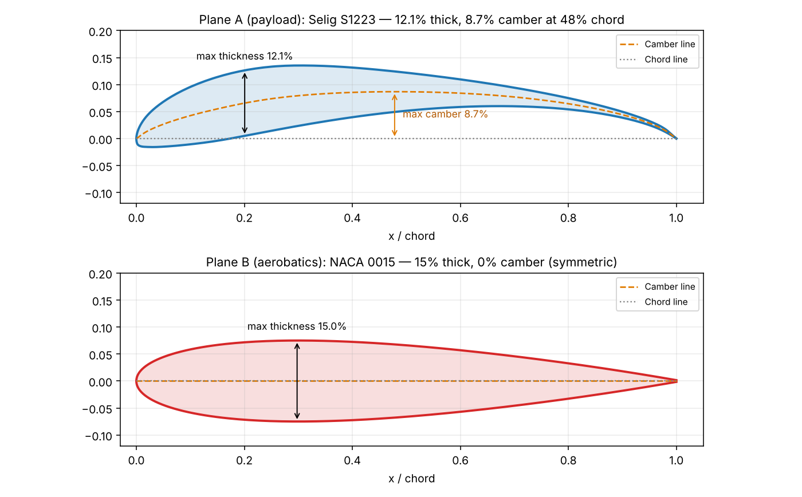
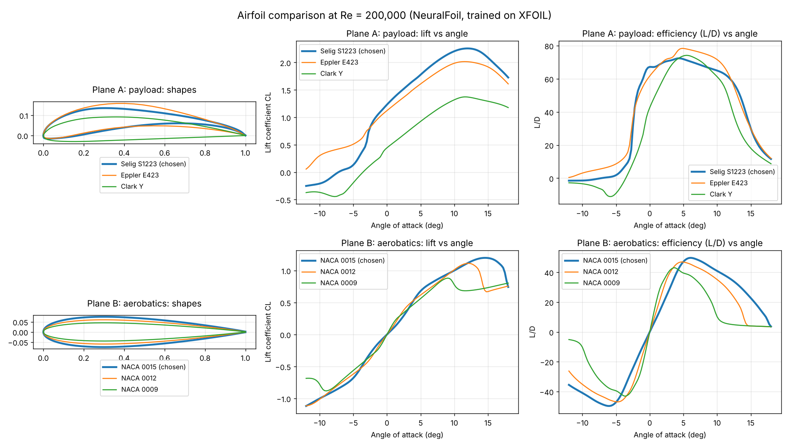

# Technical Report: Airfoil Selection for Two RC Aircraft
### IIT Mandi Aeromodelling Team — Techfest 2026, IIT Bombay

**Author:** S SHIVAS · **Date:** 23/10/2026

---

## Missions and assumptions

- **Plane A — maximum payload:** must lift as much weight as possible at low speed and fly steadily.
- **Plane B — manoeuvrability:** must turn, roll and loop, which means flying with the wing at positive and negative angles and sometimes upside down.

| Assumption | Value | Reason |
|---|---|---|
| Wingspan, chord | ≈ 1.1 m, ≈ 0.26 m | Same class of aircraft as P3 and P4 |
| Flight speed | ≈ 10–14 m/s | Typical for a 1 m electric model |
| Air | *ρ* = 1.225 kg/m³, *μ* = 1.81 × 10⁻⁵ Pa·s | Sea level (Mumbai) |
| Reynolds number | *Re* = *ρVc* ÷ *μ* = 1.225 × 12 × 0.26 ÷ 1.81 × 10⁻⁵ ≈ **211,000**, rounded to **200,000** | All airfoils compared at the same *Re* so the comparison is fair |
| Data source | NeuralFoil (open-source tool trained on XFOIL), "xlarge" model | 2D airfoil data, smooth surface, transition model as in XFOIL |

---

## 1. Shortlist

| Plane | Candidate | Type | Why it was shortlisted |
|---|---|---|---|
| A | **Selig S1223** | Highly cambered, undercambered | Designed specifically for high lift at low *Re*; widely used in SAE Aero Design heavy-lift aircraft |
| A | Eppler E423 | Highly cambered | Another dedicated high-lift low-*Re* airfoil |
| A | Clark Y | Flat-bottomed, moderate camber | Classic trainer airfoil, easy to build |
| B | **NACA 0015** | Symmetric, 15% thick | Common on aerobatic and 3D models |
| B | NACA 0012 | Symmetric, 12% thick | Classic aerobatic reference airfoil |
| B | NACA 0009 | Symmetric, 9% thick | Thin, low-drag option for fast flying |

**Reading NACA 4-digit names:** in NACA 2412, the first digit is the maximum camber (2% of chord), the second its position (40% of chord) and the last two the thickness (12% of chord). A name starting "00" has zero camber, so it is symmetric.

---

## 2. Selection

### Plane A — Selig S1223

The S1223 reaches the highest maximum lift coefficient of the three, *C*L,max = 2.26, which is 65% more than the Clark Y. Lift at a given speed is *L* = ½*ρV*²*SC*L, so more lift coefficient means more weight carried by the same wing. For a 0.29 m² wing at 10 m/s, keeping a 20% margin below the stall:

| Airfoil | Usable *C*L (0.8 × *C*L,max) | Lift *L* = ½*ρV*²*SC*L | Total mass carried (*L* ÷ *g*) |
|---|---|---|---|
| Clark Y | 1.10 | 19.5 N | ≈ 2.0 kg |
| S1223 | 1.81 | 32.1 N | ≈ 3.3 kg |

The same wing at the same speed carries about 1.3 kg more with the S1223.

**Runner-up: Eppler E423.** It is slightly more efficient (best *L/D* 78 vs 72) and stalls more gently, but gives about 10% less lift, and lift is the main requirement for Plane A.

**Known drawbacks of S1223 and how they are handled:** a strong nose-down pitching moment (*C*m ≈ −0.28), which needs a larger tailplane; a thin, curved trailing edge that is harder to build, so ribs are cut from a printed template; and higher drag, which is acceptable because Plane A flies slowly.

### Plane B — NACA 0015

A symmetric airfoil behaves the same upright and inverted and has zero pitching moment, so the aircraft does not pitch on its own. Among the three symmetric candidates, NACA 0015 has the highest maximum lift (1.20), the latest stall (14.5°) and the gentlest stall: its lift curve rounds off smoothly, while NACA 0012 loses lift sharply after about 13°. A gentle stall matters in tight turns and loops, where the wing works close to its stall angle. Its 15% thickness also leaves room for a stronger spar, needed because loops load the wing to several times the aircraft's weight.

**Runner-up: NACA 0012.** It has about 10% less minimum drag, so it would be slightly faster, but its sharper stall is riskier in tight manoeuvres at our low speeds. **NACA 0009** stalls earliest and is too thin for a strong wing.

*Figure 1 — Selected profiles with chord line, camber line, maximum thickness and maximum camber.*

---

## 3. Comparison at Re = 200,000

| Airfoil | Thickness | Max camber | *C*L at 0° | *C*L,max | Stall angle | Stall behaviour | *C*D,min | (*L/D*)max | *C*m at 0° |
|---|---|---|---|---|---|---|---|---|---|
| **Selig S1223** | 12.1% | 8.7% at 48% | 1.23 | **2.26** | 12.0° | Gentle | 0.0178 | 72 at 4.2° | −0.28 |
| Eppler E423 | 12.5% | 10.0% at 45% | 1.12 | 2.02 | 11.5° | Very gentle | 0.0182 | 78 at 4.8° | −0.24 |
| Clark Y | 11.7% | 3.4% at 42% | 0.44 | 1.37 | 11.5° | Very gentle | 0.0104 | 74 at 5.5° | −0.10 |
| **NACA 0015** | 15.0% | 0 | 0.00 | **1.20** | 14.5° | Gentle | 0.0109 | 50 at 6.0° | 0.00 |
| NACA 0012 | 12.0% | 0 | 0.00 | 1.11 | 12.0° | Sharp | 0.0098 | 47 at 4.8° | 0.00 |
| NACA 0009 | 9.0% | 0 | 0.00 | 0.88 | 9.0° | Sharp | 0.0087 | 43 at 3.8° | 0.00 |

*Stall behaviour is judged by how much CL falls in the 3° after its peak, as a percentage of CL,max: "very gentle" < 6%, "gentle" 6–20%, "sharp" > 20%. (S1223 7.5%, E423 3.5%, Clark Y 5.1%, NACA 0015 19%, NACA 0012 40%, NACA 0009 23%.)*

**What the table shows:** the cambered airfoils produce far more lift (and lift even at 0°), but also more drag and a nose-down pitching moment. The symmetric airfoils produce no lift at 0° and no pitching moment, which is exactly what makes them fly the same way inverted.

---

## 4. How airfoil geometry affects performance

- **Camber** (curvature of the mean line) bends the airflow downward even at 0° angle of attack. More camber → more lift at the same speed and a lower stall speed, but more drag, a stronger nose-down pitching moment, and poor inverted flight. *Effect on aircraft: heavier payload, slower take-off, larger tail needed.*
- **Thickness** controls how gently the flow separates near the stall and how much room there is for a spar. Thicker → gentler stall and a stronger, stiffer wing, but more drag at high speed. *Effect: safer near the stall, stronger structure.*
- **Leading-edge radius:** a rounded nose keeps the airflow attached at higher angles, giving a later and gentler stall; a sharp nose stalls suddenly.
- **Trailing edge:** a thin, upturned or curved trailing edge adds lift, but is fragile and harder to build accurately.
- **Position of maximum camber and thickness:** further back spreads the pressure more evenly and can reduce drag, but changes the pitching moment and stall behaviour.

---

## 5. Can one airfoil do both missions?

Not well. The two missions pull in opposite directions:

| Requirement | Plane A (payload) | Plane B (aerobatics) |
|---|---|---|
| Camber | High — maximum lift | Zero — same behaviour inverted |
| Pitching moment | Accept large nose-down moment | Want none |
| Lift at 0° | High | Zero |

A **semi-symmetric** airfoil such as NACA 2412 (2% camber) is the compromise: it lifts less than the S1223, so Plane A would carry less, and it flies differently upright and inverted, so Plane B's loops and rolls would need constant correction. It would be average at both.

The practical way to cover both missions is an **aircraft feature, not an airfoil**: flaps, which add camber for take-off and heavy loads and are retracted for aerobatics.

---

## 6. Airfoil characteristics vs whole-aircraft factors

| Set by the **airfoil** (2D section) | Set by the **whole aircraft** |
|---|---|
| *C*L,max, *C*D and *L/D* of the section | **Wing loading** *W/S* → stall speed and turn radius |
| How gently it stalls | **Aspect ratio** *AR* = *b*² ÷ *S* → induced drag and roll rate |
| Pitching moment *C*m | **Control surfaces** — size and travel of ailerons, elevator, rudder |
| Room for a spar (thickness) | **Structure** — whether the wing survives the loads of a loop |
| | **Thrust-to-weight** *T/W* → climb and vertical manoeuvres |
| | **CG position** → stable or agile |

An airfoil's numbers describe an infinitely long wing section. A real 3D wing loses some lift at the tips, so the whole wing's lift coefficient is lower than the section's. An aerobatic airfoil on a heavy aircraft with a weak motor and small ailerons still will not loop: the airfoil is necessary, but not sufficient.

---

## Bonus — Simulation comparison

*Figure 2 — All six airfoils at Re = 200,000: shapes (left), lift coefficient vs angle of attack (centre), lift-to-drag ratio vs angle of attack (right). Plane A on top, Plane B below.*

**Method:** airfoil coordinates from the UIUC Airfoil Coordinates Database; lift, drag and moment computed with NeuralFoil (a neural network trained on XFOIL results) at Re = 200,000, angle of attack −12° to +18° in 0.25° steps.

**Limitations:** results are for a 2D section with a perfectly smooth surface; a built foam wing is rougher and will perform somewhat worse. Predictions are least reliable near and beyond the stall. Results should be cross-checked in XFLR5 (Re = 200,000, Ncrit = 9) or against the XFOIL polars published on airfoiltools.com.

---

## References

1. Selig, M. S. and Guglielmo, J. J., "High-Lift Low Reynolds Number Airfoil Design", *Journal of Aircraft*, 34(1), 1997 — origin of the S1223.
2. UIUC Airfoil Coordinates Database — https://m-selig.ae.illinois.edu/ads/coord_database.html
3. Sharpe, P., NeuralFoil — https://github.com/peterdsharpe/NeuralFoil
4. Airfoil Tools (XFOIL polars for cross-checking) — http://airfoiltools.com
5. Club learning playlist — https://youtube.com/playlist?list=PLpdZAunkELHiN85JpFReHTf-5X-gh6MhV
6. AI use: Claude (Anthropic) was used to run the airfoil analysis, draw the figures and structure this report. All content was reviewed by the author.
