# Technical Report: The Paper Plane Challenge
### IIT Mandi Aeromodelling Team — Selection Task, Problem 2

**Author:** S SHIVAS · **Date:** 26/10/2026

**Goal:** the longest **time aloft** (not distance) from one A4 sheet, folded and cut only — no tape, glue, clips or propulsion — launched by hand.

---

## Assumptions

| Item | Value | Basis |
|---|---|---|
| Paper | A4, 210 × 297 mm, 75 g/m² | Typical Indian copier paper; weigh one sheet to confirm |
| Mass and weight | *m* = 0.210 × 0.297 × 75 = **4.68 g**; *W* = *mg* = **0.046 N** | |
| Air density | *ρ* ≈ 1.11 kg/m³ | IIT Mandi, Kamand campus, ≈ 1,000 m altitude |
| Release height | ≈ 1.8 m | Hand height at release |
| Lift coefficient in glide | *C*L ≈ 0.7 | Typical for a paper glider; not measured |
| Glide ratio | *L/D* ≈ 4 | Typical for a low-aspect-ratio paper wing; not measured |
| Keel depth | *d* ≈ 20 mm | Estimated from photos; measure to refine |

---

## Part A — Design

### A1. Construction

The design is a **locked-nose glider** in the style of the traditional *Nakamura lock*: a blunt, multi-layered nose held shut by a small locking flap, with wide wings and small upturned wingtips.

| Step | Photo | Fold |
|---|---|---|
| 1 | 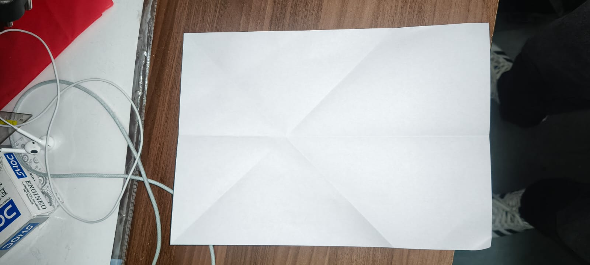 | Crease the centre line and the corner diagonals on a flat A4 sheet. |
| 2 | 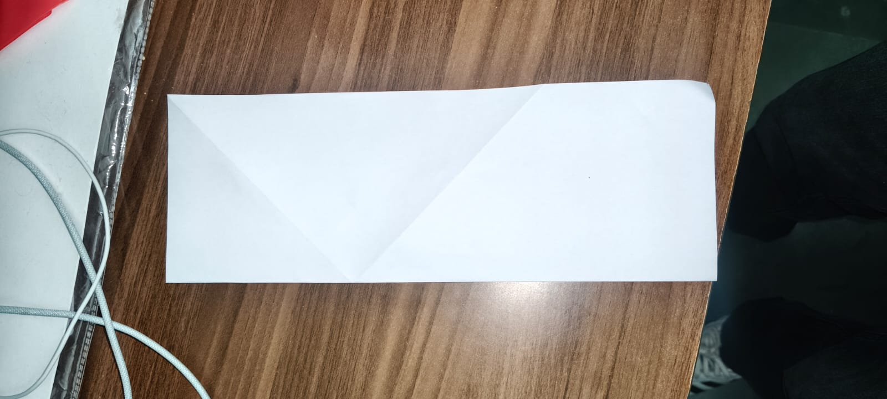 | Fold in half lengthwise to set the centre crease; unfold. |
| 3 | 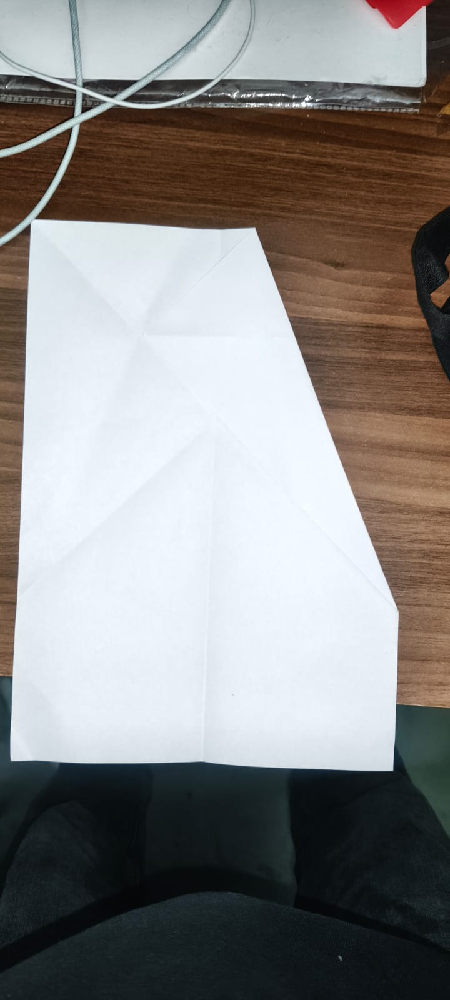 | Fold the first top corner to the diagonal crease. |
| 4 | 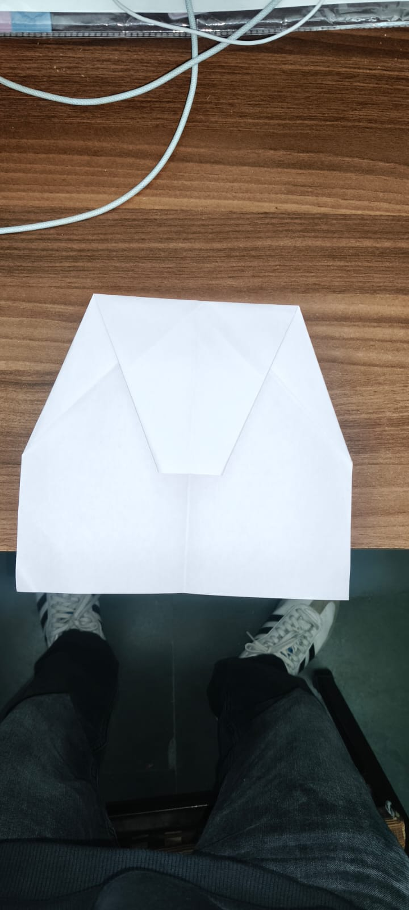 | Fold the second corner in, then fold the pointed tip down to form a flat top edge. |
| 5 | 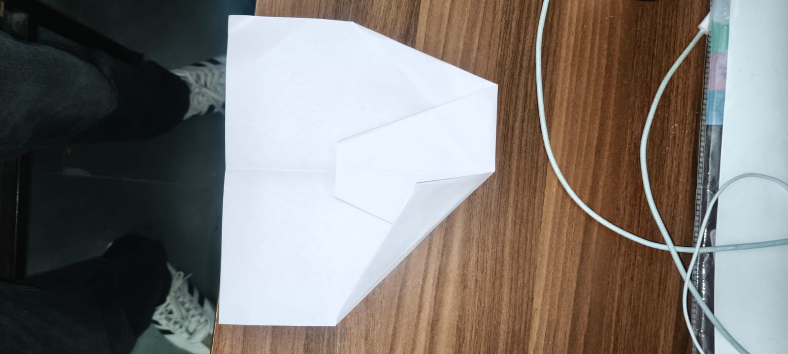 | Fold the new top corners to the centre line again, leaving the tip of the flap showing. |
| 6 | 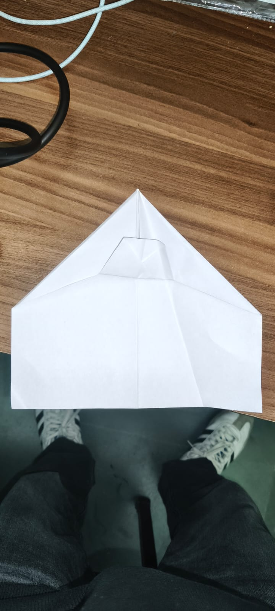 | Fold the small exposed tip up over the corners — this **locks** the nose layers together. |
| 7 | 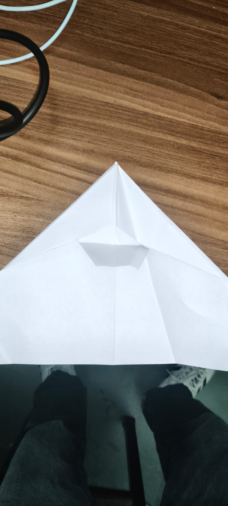 | Close-up of the nose lock. |
| 8 | 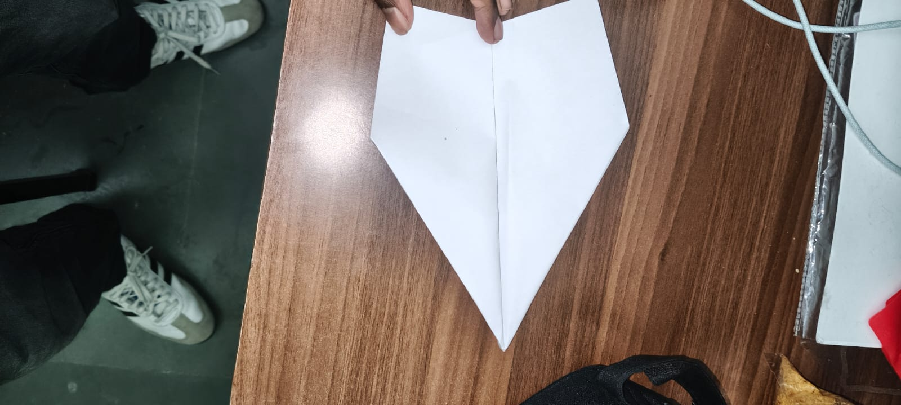 | Finished flat outline: pointed, layered nose and straight wing edges. |
| 9 | 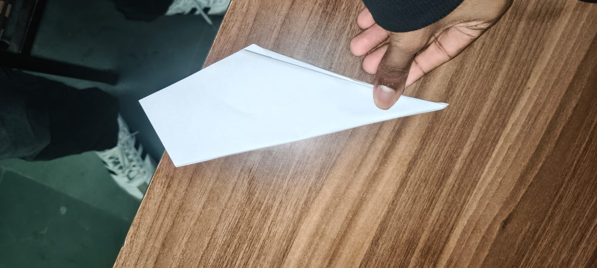 | Fold in half along the centre crease, lock outside. |
| 10 | 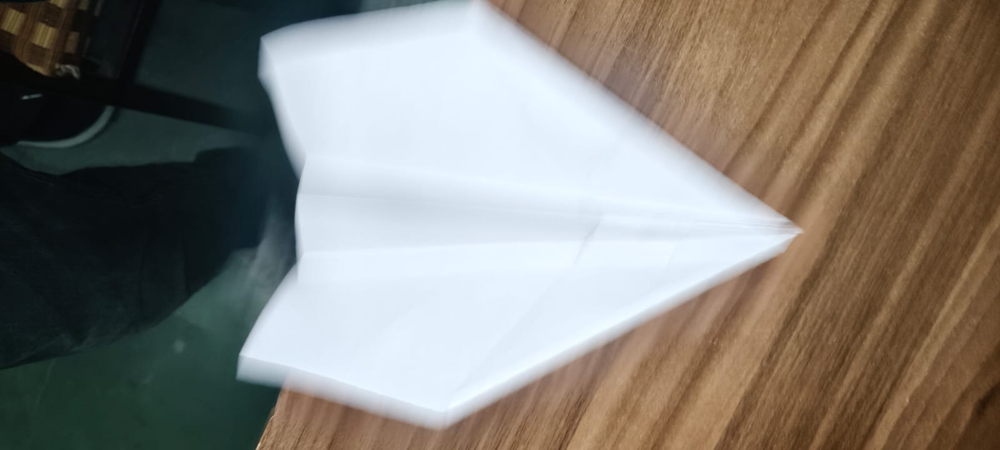 | Fold each wing down, leaving a narrow keel; fold small wingtips up. |

**Finished aircraft:**

| Top view | Front view | Front view (on desk) |
|---|---|---|
| 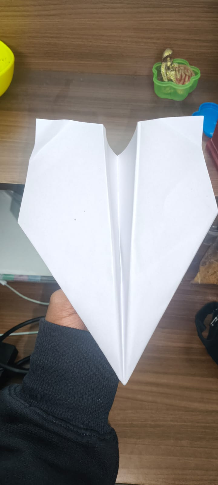 | 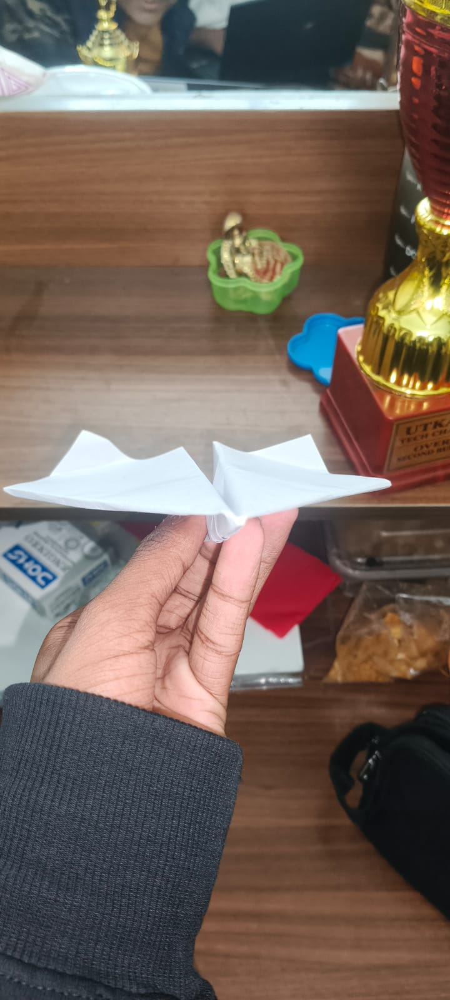 | 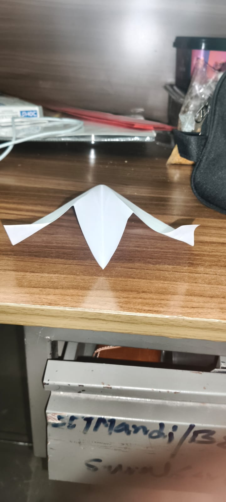 |

**Source:** Nakamura lock, a traditional paper-aircraft design (attributed to Eiji Nakamura); widely published folding instructions.

### A2. Wing shape, dimensions and configuration

The fold sequence fixes the flat outline exactly. After steps 3–5 the nose is 105 mm below the original top edge, so:

| Dimension | Formula | Value |
|---|---|---|
| Length (nose to tail) | 297 − 105 | **192 mm** |
| Flat width | A4 width | **210 mm** |
| Flat planform area | rectangle + nose triangle = 210 × 87 + ½ × 210 × 105 | **0.0293 m²** |
| Wingspan (wings down) | *b* = 210 − 2*d* | **≈ 170 mm** |
| Wing area | *S* = flat area − keel strip ≈ 0.0293 − (2*d* × 192 − *d*²)/10⁶ | **≈ 0.022 m²** |
| Aspect ratio | *AR* = *b*² ÷ *S* | **≈ 1.3** |

**Why this configuration suits time aloft:**

- **Wide, broad wings:** most of the sheet becomes wing area, so the wing loading is low and the plane can fly slowly.
- **Layered, locked nose:** the repeated nose folds stack several paper layers at the front. This moves the centre of gravity forward without a paper clip (which the rules forbid) and makes the nose stiff, so it keeps its shape over many throws.
- **Narrow keel:** a small vertical fin underneath acts like a rudder and a handle, keeping the plane pointing straight (yaw stability).
- **Upturned wingtips:** act as small vertical fins at the wingtips, adding yaw and roll stability and reducing the air leaking around the tips.
- **Why not a dart:** a dart has small, swept wings and high wing loading, so it flies fast and loses height quickly. That suits distance, not time (see B4).

---

## Part B — Aerodynamics

### B1. How the plane generates lift

The wing meets the air at a small positive angle of attack, and the slight upward bend of the trailing edge adds camber. Both deflect the passing air downward. By Newton's third law, the air pushes the wing up. Equivalently, the air flowing over the upper surface is at lower pressure than the air underneath, and the pressure difference produces lift:

*L* = ½ · *ρ* · *V*² · *S* · *C*L

### B2. Forces during launch and glide

| Phase | Thrust | Lift | Weight | Drag |
|---|---|---|---|---|
| **Launch** (in the hand) | From the arm, for a fraction of a second | Builds with speed | Constant | Grows with speed |
| **Climb** after release | **None** — the plane coasts on the energy of the throw | Pulls the path upward | Constant | Slows the plane |
| **Steady glide** | **None** | ≈ *W* cos *γ* | Constant | ≈ *W* sin *γ* |

There is no sustained propulsion. After release the plane trades height for speed: a small part of its weight, acting along the downward glide path, does the job of thrust and keeps air flowing over the wing. The glide angle *γ* is set by the lift-to-drag ratio, tan *γ* = *D* ÷ *L*. The flight lasts only as long as the height lasts, so the goal is to lose height as slowly as possible.

### B3. Wing area, wing loading, centre of gravity and stability

**Wing loading:** *W/S* = 0.046 ÷ 0.022 ≈ **2.1 N/m²** — about one-twentieth of our RC trainer's 40 N/m². A low wing loading means only a low speed is needed to make lift equal to weight.

**Glide speed** (lift = weight): *V* = √(2*W* ÷ (*ρ S C*L)) = √(2 × 0.046 ÷ (1.11 × 0.022 × 0.7)) ≈ **2.3 m/s**

**Sink rate:** *v*s ≈ *V* ÷ (*L/D*) = 2.3 ÷ 4 ≈ **0.58 m/s**

**Predicted time** for a pure glide from release height: *t* = *h* ÷ *v*s = 1.8 ÷ 0.58 ≈ **3.1 s**. The measured mean (5.9 s, Part C) is longer because the throw first carries the plane upward; the measured time implies the glide started from about *v*s × *t* = 0.58 × 5.9 ≈ **3.4 m**, roughly 1.6 m above the hand.

**Centre of gravity:** the stacked nose layers put the CG ahead of the wing's centre of lift.

**Stability:**
- *Pitch:* with the CG ahead of the lift, a nose-down disturbance makes the plane speed up, which raises lift and brings the nose back up; the small up-bend at the trailing edge sets a steady, slow glide.
- *Roll:* the slight upward angle of the wings (dihedral) and the upturned tips level the wings after a disturbance.
- *Yaw:* the keel and the wingtip fins keep the nose pointing into the airflow, like the feathers on an arrow.

### B4. Why this design outlasts a dart — minimum sink vs maximum glide distance

| | Maximum glide **distance** | Minimum **sink rate** (maximum time) |
|---|---|---|
| What it maximises | Horizontal distance per metre of height lost | Seconds aloft per metre of height lost |
| Flown at | The speed for best *L/D* — faster | A slower speed, nearer the stall |
| Suits | Dart: small area, high wing loading | Broad-winged glider: large area, low wing loading |
| This challenge | ✗ | ✓ |

Time aloft ≈ starting height ÷ sink rate, so the plane that sinks most slowly stays up longest, even if it travels less far. Because sink rate rises with speed, and speed rises with wing loading (*V* ∝ √(*W/S*)), the broad, lightly loaded wing of this design sinks more slowly than a dart's small, heavily loaded wing.

---

## Part C — Experiment

### C1. Test conditions

| Variable | Kept constant |
|---|---|
| Aircraft | Same plane for all five trials, not re-trimmed between throws |
| Location | Outdoor court, IIT Mandi (Kamand campus), calm conditions |
| Launch | Same thrower, same overarm launch, released at about hand height |
| Timing | Release to first touch of the ground |

### C2. Results

| Trial | Time aloft (s) |
|---:|---:|
| 1 | 5.27 |
| 2 | 6.12 |
| 3 | 6.03 |
| 4 | 5.23 |
| 5 | 7.02 |
| **Mean** | **5.93** |
| Standard deviation | 0.73 |
| Minimum / maximum | 5.23 / 7.02 |

Mean: *t̄* = Σ*t*i ÷ *n* = 29.67 ÷ 5 = **5.93 s**

Standard deviation: *s* = √(Σ(*t*i − *t̄*)² ÷ (*n* − 1)) = **0.73 s** — a spread of about 12% of the mean.

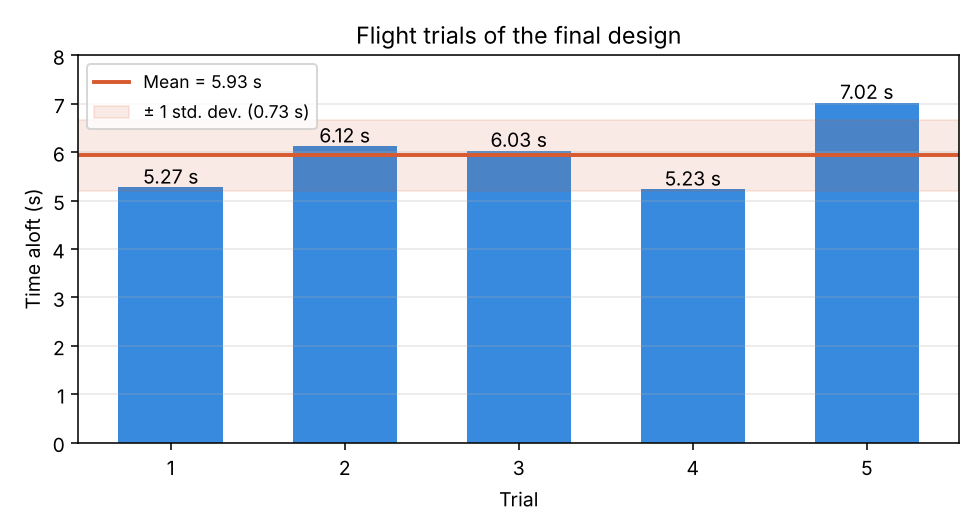

**Video of a test flight:** [media/test_flight.mp4](media/test_flight.mp4)

**Observations:** all five flights lasted more than 5 s, with the longest at 7.02 s. The 12% spread comes mainly from the hand launch — throw strength and angle change slightly every time, which changes the height the plane reaches before it starts gliding — and from any small air movement outdoors.

### C3. Proposed modifications

Each test changes **one variable only**; everything in C1 stays the same. Where a change cannot be undone, an identical second plane is folded from the same paper. Each setting gets at least 5 trials, and the means are compared with their standard deviations.

**Modification 1 — Trailing-edge up-bend (elevator)**
- *Change:* bend the rear edge of both wings up by 0°, ≈ 5° and ≈ 10°.
- *Hypothesis:* a moderate up-bend raises the nose slightly, slowing the glide and reducing the sink rate; too much makes the plane climb, stall and dive in a repeating "porpoise" pattern, shortening the flight.
- *Controlled:* same plane, same thrower and launch, same location.

**Modification 2 — Launch method**
- *Change:* compare the current overarm throw with a firm throw angled about 45° upward, and with a gentle level release from the same height.
- *Hypothesis:* a steeper upward throw raises the starting height of the glide (time ≈ height ÷ sink rate), lengthening the flight, as long as the plane recovers into a smooth glide at the top.
- *Controlled:* same plane and trim, same thrower, same location; only the throw changes.

---

## Limitations

- Hand launches are not perfectly repeatable, which causes most of the spread between trials.
- Testing was outdoors; even a light breeze can lengthen or shorten a flight.
- The lift coefficient and glide ratio in B3 are typical values, not measurements; the keel depth and paper weight are estimates.

---

## References

1. Nakamura lock — traditional paper-airplane design, attributed to Eiji Nakamura.
2. Club learning playlist — https://youtube.com/playlist?list=PLpdZAunkELHiN85JpFReHTf-5X-gh6MhV
3. AI use: AI tools were used to help structure this report and check the calculations and statistics. The aircraft was built, flown and timed by the author.
