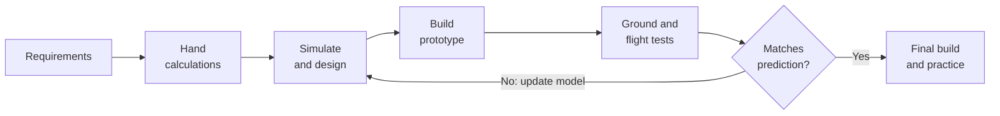
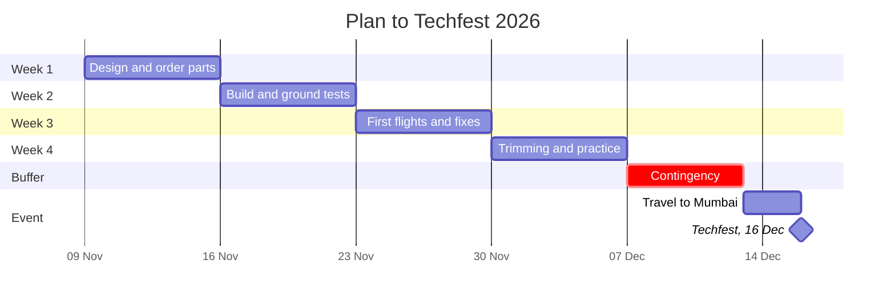

# Technical Proposal: Development Approach for an RC Aircraft
### IIT Mandi Aeromodelling Team - Techfest 2026, IIT Bombay (16–18 Dec 2026)

**Author:** S SHIVAS · **Role:** Lead designer · **Date:** 23/10/2026

**Assumptions:** every figure used below, with its source, is listed in [P3_assumptions_and_weight.xlsx](P3_assumptions_and_weight.xlsx) (tabs *Assumptions* and *Weight Build-up*).

---

## Decision

**We will use a hybrid approach: _simulate to decide, build to confirm._** Hand calculations and simulation rule out bad designs cheaply; a low-cost foam prototype is built early; test data is fed back to correct the simulation. With four weeks, about ₹13,500 and a competition 2,000 km away, we can afford neither many crashed prototypes nor blind trust in untested numbers. The hybrid approach reduces both risks.

## 1. Advantages and limitations

| | **Simulation-led** - design and check on the computer first | **Prototype-led** - build, fly, fix, repeat |
|---|---|---|
| **Advantages** | • Trying ideas is nearly free - changing span or airfoil is an edit, not a new wing • Shows what is hard to measure: stability, lift spread, spar stress • Catches major mistakes before money is spent | • Real-world truth - if it flies, it flies • Builds construction and piloting skill • Finds what simulation cannot: bad CG, weak joints, vibration |
| **Limitations** | • Only as good as its inputs - a wrong weight gives wrong answers, with no warning • Assumes a perfect, exactly-built plane • Ignores wind, vibration, rough runways, pilot error | • Every crash costs parts (₹105 prop, ₹119 servo, ₹499 motor) and days • Hard to tell *why* it failed when several things changed • Can waste weeks on a design flawed from the start |

Each method's weakness is the other's strength - which is why we combine them.

## 2. Comparison

| Factor | Simulation-led | Prototype-led | **Hybrid (chosen)** |
|---|---|---|---|
| **Cost** | Low - no materials | High - materials and crash repairs | Medium - fewer wasted builds |
| **Time** | Hours per design check | Days per build-fly-repair cycle | Short design phase, 2 focused builds |
| **Accuracy** | Good for trends; misses real-world effects | Real, but noisy (pilot, wind) | Simulation corrected by test data |
| **Iteration speed** | Very fast | Slow | Fast early, fewer but better builds later |
| **Failure detection** | Design flaws, before building | Build and real-world flaws, after building | Both |
| **Final performance** | Risky if never flown | Works, but may not be the best design | Most reliable |

## 3. Development workflow

**Stages:** requirements from the Techfest rulebook → first sizing by hand (below) → simulate lift, stability and spar strength → build a foam prototype, weighing every part → ground tests (weight, CG, thrust, controls) and flights → compare with predictions. The **No** loop back to design is the core of the approach: every test makes the model more accurate.

**First-size calculation (stage 2):** weight *W* = *mg* · wing area *S* = *W* ÷ (*W/S*) · chord *c* = *S* ÷ *b* · aspect ratio *AR* = *b*² ÷ *S* · lift *L* = ½*ρV*²*SC*L · stall speed *V*stall = √(2*W* ÷ *ρSC*L,max) · take-off speed ≈ 1.2 *V*stall · thrust-to-weight *T/W* · CG *x*CG = Σ*m*i*x*i ÷ Σ*m*i. (*W/S* = wing loading, *b* = span, *ρ* = air density, *C*L = lift coefficient.)

## 4. Parameters: simulate vs verify

| Parameter | Method | Why |
|---|---|---|
| Lift, drag and stall speed of the wing | **Simulate** | Cannot measure without a wind tunnel |
| Stability - will the plane recover from a gust? | **Simulate** | Better known before risking a crash |
| Stress and bending in the wing spar | **Simulate** | Avoid wing failure in turns or hard landings |
| Actual weight and CG | **Verify** - scale, balance on two supports | Builds always come out heavier than planned |
| Static thrust | **Verify** - plane on a scale at full throttle | Real thrust is below datasheet; battery voltage sags |
| Control direction and travel | **Verify** - move each stick, measure deflection | Reversed or weak controls cannot be simulated |

## 5. Validating the simulation

**1 — Measure** (repeat each test *n* times; mean *x̄* = Σ*x*i ÷ *n*, scatter *s* = √(Σ(*x*i − *x̄*)² ÷ (*n* − 1))):

| Quantity | Measurement | Formula |
|---|---|---|
| Weight | Weigh the complete aircraft | *W* = *m*meas *g* |
| Static thrust | Change in scale reading *Δm* at full throttle | *T* = *Δm g*;  *T/W* = *T* ÷ *W* |
| CG | Readings *R*1, *R*2 on two supports *L* apart | *x*CG = *R*2*L* ÷ (*R*1 + *R*2) from support 1 |
| Glide | Unpowered launch from height *h*: distance *d*, time *t* | *L/D* = *d* ÷ *h*;  sink rate *v*s = *h* ÷ *t* |
| Power use | Charge replaced *C*used after a flight of *t*flight | *I* = *C*used ÷ *t*flight |

**2 — Compare:** error *e* = (*x*meas − *x*pred) ÷ *x*pred × 100%. The prediction is accepted if |*e*| ≤ *ε*, a tolerance the team sets **before** testing; a difference smaller than the test scatter *s* is not a model error.

**3 — Correct and re-predict:** replace the prediction with the measurement and recompute what depends on it - e.g. *V*stall,new = *V*stall,pred · √(*m*meas ÷ *m*pred), and real drag *D* = *W* ÷ (*L/D*). Once |*e*| ≤ *ε* for every measured quantity, the model describes the real aircraft and can be trusted for further changes.

## 6. Simulates well, but the prototype won't take off

| Plausible cause | Why simulation missed it |
|---|---|
| Too heavy - extra glue, wires, heavier battery | Used planned weight |
| Too little thrust - weak motor/prop, voltage sag, cold battery at Kamand | Used datasheet thrust |
| Wrong CG - nose-heavy can't lift off; tail-heavy stalls | Assumed ideal CG |
| Elevator reversed or too little travel | Controls not modelled |
| Warped wing or wrong wing angle | Assumed perfect build |
| Rough grass, tailwind, short runway; drag from gear and wires | Assumed ideal, smooth conditions |

**Diagnostic plan** - cheapest and most likely checks first; change **one** thing at a time (design values from the assumptions sheet):

1. **Weigh it.** Over the 1,200 g design weight? Strip excess glue and tape, shorten wires.
2. **Check CG** at 65 mm behind the leading edge (25% of chord). Off? Move the battery.
3. **Check controls.** Wrong direction or too little travel? Reverse the channel or adjust the linkage.
4. **Measure thrust.** Below 600 g (50% of weight)? Larger prop, warm fresh battery, or different motor.
5. **Glide test, motor off.** Smooth glide → wing and CG are fine, so the problem is **power or runway**. Dives or stalls → **CG or wing**.
6. **Inspect the wing** for twist and correct mounting angle.
7. **Change take-off method:** smoother, longer runway or hand-launch.
8. **Update the model** with every real value found.

## Bonus - Four-week schedule with contingency

| Week | Dates | Work | Milestone |
|---|---|---|---|
| 1 | 9–15 Nov | Requirements, calculations, simulation; **order parts on day 1** (4–6 days to Mandi) | Design frozen |
| 2 | 16–22 Nov | Build prototype; ground tests (weight, CG, thrust, controls) | Ready to fly |
| 3 | 23–29 Nov | First flights, compare with predictions, fix, build improved version | Stable plane |
| 4 | 30 Nov – 6 Dec | Trimming, pilot practice, pack-and-reassemble test | Competition-ready |
| Buffer | 7–12 Dec | **Contingency** for crashes, repairs, late parts | - |
| Travel | 13–15 Dec | Mandi → Mumbai | Techfest 16 Dec |

**Main risks:** crash → ₹2,000 spares kit and time for a second airframe; late parts → order on day 1 from two suppliers; transit damage → detachable wing, padded box, spares and glue gun carried to the venue.

## References

1. Anderson, J. D., *Introduction to Flight*, McGraw-Hill — lift, stall speed and glide relations.
2. Component prices: Probots (probots.co.in), Robu (robu.in), checked 23 Oct 2026.
3. Techfest 2026, IIT Bombay — official competition rulebook.
4. Club learning playlist — https://youtube.com/playlist?list=PLpdZAunkELHiN85JpFReHTf-5X-gh6MhV
5. AI use: AI tools supported the research, structure and price look-ups; all content was reviewed by the author.
