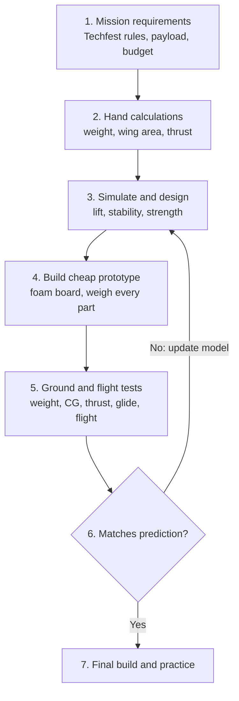
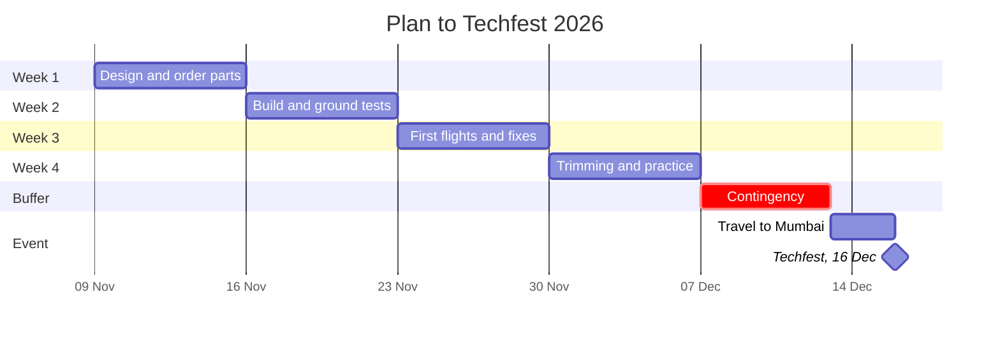

# Technical Proposal: Development Approach for an RC Aircraft
### IIT Mandi Aeromodelling Team - Techfest 2026, IIT Bombay (16–18 Dec 2026)

**Author:** S SHIVAS · **Role:** Lead designer · **Date:** 23/10/2026

---

## Decision

**We will use a hybrid approach: _simulate to decide, build to confirm._**
Hand calculations and simulation rule out bad designs cheaply; a low-cost foam prototype is built early; test data is fed back to correct the simulation. With four weeks, about ₹15,000 and a competition 2,000 km away, we can afford neither many crashed prototypes nor blind trust in untested numbers. The hybrid approach reduces both risks.
---

## 1. Advantages and limitations

| | **Simulation-led design** - design and check on the computer first | **Prototype-led design** - build, fly, fix, repeat |
|---|---|---|
| **Advantages** | • Trying ideas is nearly free - changing span or airfoil is an edit, not a new wing • Shows what is hard to measure: stability, lift spread along the wing, stress in the spar • Catches major mistakes (e.g. wing too small for the weight) before money is spent • Team can design while parts are still in transit to Mandi | • Real-world truth - if it flies, it flies • Builds construction and piloting skill with every iteration • Finds what simulation cannot: bad CG, weak joints, vibration, weak servos • Pilot practises on the actual competition aircraft |
| **Limitations** | • Only as good as its inputs - a wrong weight gives wrong answers, with no warning • Assumes a perfect, smooth, exactly-built plane • Ignores wind, vibration, rough runways and pilot error • Learning curve; easy to over-trust a neat graph | • Every crash costs parts (₹105 prop, ₹119 servo, ₹499 motor) and days of repair • Hard to tell *why* it failed when several things changed at once • Can waste weeks fixing a design that was flawed from the start • Waiting for replacement parts in Mandi is slow |

Each method's weakness is the other's strength - which is why we combine them.

---

## 2. Comparison

| Factor | Simulation-led | Prototype-led | **Hybrid (chosen)** |
|---|---|---|---|
| **Cost** | Low - no materials | High - materials and crash repairs | Medium - fewer wasted builds |
| **Time** | Hours per design check | Days per build-fly-repair cycle | Short design phase, 2 focused builds |
| **Accuracy** | Good for trends; misses real-world effects | Real, but noisy (pilot, wind) | Simulation corrected by test data |
| **Iteration speed** | Very fast | Slow | Fast early, fewer but better builds later |
| **Failure detection** | Design flaws, before building | Build and real-world flaws, after building | Both |
| **Final performance** | Risky if never flown | Works, but may not be the best design | Most reliable |

---

## 3. Development workflow

| Stage | What we do | Output |
|---|---|---|
| 1. Requirements | Read Techfest rulebook; fix span, payload, budget, deadline | Requirement list |
| 2. Hand calculations | Size the wing and motor (below) | First-size numbers |
| 3. Simulate & design | Choose airfoil; check stability and spar strength; draw parts | Design + predictions |
| 4. Manufacture | Cut foam, fit spar, install electronics; weigh every part | Prototype + weight log |
| 5. Test | Ground tests, then first flights | Measured data |
| 6. Refine | Compare with predictions; update model; fix design | Improved design |
| 7. Final | Final build, trimming, pilot practice | Competition aircraft |

**First-size calculation (stage 2):**

| Quantity | Formula |
|---|---|
| Weight | *W* = *m* · *g* |
| Wing area | *S* = *W* ÷ (*W/S*) |
| Mean chord | *c* = *S* ÷ *b* |
| Aspect ratio | *AR* = *b*² ÷ *S* |
| Lift | *L* = ½ · *ρ* · *V*² · *S* · *C*L |
| Stall speed | *V*stall = √( 2*W* ÷ (*ρ* · *S* · *C*L,max) ) |
| Take-off speed | *V*TO ≈ 1.2 · *V*stall |
| Thrust-to-weight ratio | *T/W* = static thrust ÷ weight |
| CG position | *x*CG = Σ(*m*i · *x*i) ÷ Σ*m*i |

*m* = all-up mass · *g* = 9.81 m/s² · *W/S* = wing loading · *b* = wingspan · *ρ* = air density · *V* = airspeed · *C*L = lift coefficient · *m*i, *x*i = mass and position of each component

---

## 4. Parameters: simulate vs verify

| Study through **simulation** | Why |
|---|---|
| 1. Lift, drag and stall speed of the wing | Cannot measure without a wind tunnel |
| 2. Stability - will the plane recover from a gust? | Better known before risking a crash |
| 3. Stress and bending in the wing spar | Avoid wing failure in turns or hard landings |

| Verify **physically** | Why | How |
|---|---|---|
| 1. Actual weight and CG | Builds always come out heavier than planned | Kitchen scale; balance on fingertips |
| 2. Static thrust | Real thrust is below datasheet; battery voltage sags | Plane strapped to a scale at full throttle |
| 3. Control surface direction and travel | Reversed or weak controls cannot be simulated | Move each stick; measure deflection |

---

## 5. Validating the simulation

Measure a quantity on the real aircraft, compare it with the predicted value, and correct the model when they disagree.

**Step 1 — Measure (repeat each test *n* times and average):**

| Quantity | How it is measured | Formula |
|---|---|---|
| Mass and weight | Weigh the complete aircraft | *W* = *m*meas · *g* |
| Static thrust | Aircraft on a scale, nose up, full throttle; *Δm* = change in scale reading | *T* = *Δm* · *g* · *T/W* = *T* ÷ *W* |
| CG position | Rest the aircraft on two supports a distance *L* apart; *R*1, *R*2 = scale readings under each | *x*CG = (*R*2 · *L*) ÷ (*R*1 + *R*2), measured from support 1 |
| Glide ratio | Unpowered hand-launch from height *h*; measure ground distance *d* and time *t* | *L/D* = *d* ÷ *h* · *γ* = tan⁻¹(*h* ÷ *d*) · sink rate *v*s = *h* ÷ *t* |
| Flight time | Fly until the low-voltage alarm; *C*used = charge put back by the charger | average current *I* = *C*used ÷ *t*flight |
| Average of repeated tests | *x*1 … *x*n | *x̄* = Σ*x*i ÷ *n* · *s* = √( Σ(*x*i − *x̄*)² ÷ (*n* − 1) ) |

**Step 2 — Compare:**

$$e = \frac{x_{\text{meas}} - x_{\text{pred}}}{x_{\text{pred}}} \times 100\%$$

The prediction is accepted if |*e*| ≤ *ε*, where *ε* is the tolerance the team sets for each quantity before testing. A difference smaller than the scatter between repeated tests (*s*) cannot be called a model error.

**Step 3 — Correct and re-predict:** replace the predicted value with the measured one and recompute what depends on it. For example, a mass change alters stall speed as

$$V_{\text{stall,new}} = V_{\text{stall,pred}} \cdot \sqrt{\frac{m_{\text{meas}}}{m_{\text{pred}}}}$$

and a measured glide ratio gives the real drag of the aircraft as *D* = *W* ÷ (*L/D*).

Repeat steps 1-3 after every design change. Once |*e*| ≤ *ε* for all measured quantities, the model describes the real aircraft and can be trusted to predict the effect of further changes.

---

## 6. Simulates well, but the prototype won't take off

**Plausible causes** (each one a real-world effect the simulation did not include):

| Cause | Why simulation missed it |
|---|---|
| Too heavy - extra glue, wires, heavier battery | Used planned weight |
| Too little thrust - weak motor/prop, voltage sag, cold battery at Kamand | Used datasheet thrust |
| Wrong CG - nose-heavy can't lift off; tail-heavy stalls | Assumed ideal CG |
| Elevator reversed or too little travel | Controls not modelled |
| Warped wing or wrong wing angle | Assumed perfect build |
| Rough grass, tailwind, short runway; drag from gear and wires | Assumed ideal, smooth conditions |

**Diagnostic plan** — cheapest and most likely checks first; change **one** thing at a time:

1. **Weigh it.** Over 1,200 g? Strip excess glue and tape, shorten wires.
2. **Check CG** at the 65 mm mark. Off? Move the battery.
3. **Check controls.** Wrong direction or too little travel? Reverse channel / adjust linkage.
4. **Measure thrust.** Below 600 g? Larger prop, warm fresh battery, or different motor.
5. **Glide test, motor off.** Smooth glide → wing and CG are fine, so the problem is **power or runway**. Dives or stalls → the problem is **CG or wing**.
6. **Inspect the wing** for twist and correct mounting angle.
7. **Change take-off method:** smoother, longer runway or hand-launch.
8. **Update the model** with every real value found.

---

## Bonus — Four-week schedule with contingency

| Week | Dates | Work | Milestone |
|---|---|---|---|
| 1 | 9–15 Nov | Requirements, calculations, simulation; **order parts on day 1** (4–6 days to Mandi) | Design frozen |
| 2 | 16–22 Nov | Build prototype; ground tests (weight, CG, thrust, controls) | Ready to fly |
| 3 | 23–29 Nov | First flights, compare with predictions, fix, build improved version | Stable plane |
| 4 | 30 Nov – 6 Dec | Trimming, pilot practice, pack-and-reassemble test | Competition-ready |
| Buffer | 7–12 Dec | **Contingency** for crashes, repairs, late parts | — |
| Travel | 13–15 Dec | Mandi → Mumbai | Techfest 16 Dec |

**Main risks:** crash → ₹2,000 spares kit and time for a second airframe; late parts → order on day 1 from two suppliers; transit damage → detachable wing, padded box, spares and glue gun carried to the venue.

---

## References

1. Component prices: Probots (probots.co.in), Robu (robu.in), checked 23 Oct 2026.
2. Club learning playlist — https://youtube.com/playlist?list=PLpdZAunkELHiN85JpFReHTf-5X-gh6MhV
3. Techfest 2026, IIT Bombay — official competition rulebook.
4. AI use: AI tools were used to support research, structure this proposal and look up component prices. All content was reviewed by the author.
